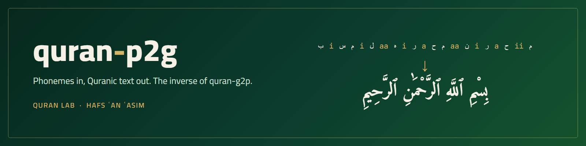
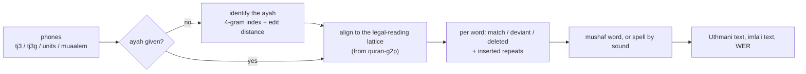

<p align="center">
  
</p>

<p align="center">
  
  
  
  
</p>

**Phonemes in, Quranic text out, so a phoneme model gets a word error rate that means what a text model's
means.**

Phoneme-level Quran models (TajweedFormer, the zipformer phoneme models, muaalem) write phones. Text ASR
writes words. To put both on one leaderboard you need to turn phones back into the mushaf's words, and in the
Quran that can be done exactly: the reciter is reading a known ayah, so every legal way of reading it is known.
quran-p2g aligns the phones to that set of legal readings, writes the mushaf word wherever the phones are one of
them, and spells what was actually said wherever they are not.

It is the inverse companion of [quran-g2p](https://github.com/Quran-Lab/quran-g2p), the rule engine every legal
reading here comes from.

```python
import quran_p2g as p2g

said = "ء a ل ح a م د i ل i ل aa ه i ر a ب i ل ء aa ل a م ii ن"   # 1:2 with two slips
r = p2g.convert(said, ayah="1:2", fmt="tj3")
r.text          # 'ٱلْحَمْدِ لِلَّهِ رَبِّ ٱلْءَالَمِينْ'
r.text_imlaei   # 'الحمد لله رب الآلمين'
[(w.status, w.level) for w in r.words]
# [('deviant', 'harakat'), ('match', None), ('match', None), ('deviant', 'letters')]
p2g.wer(r, "1:2").wer, p2g.wer(r, "1:2", diacritics=True).wer   # (0.25, 0.5)
```

The damma of الحمد was read as a kasra: a phonetic deviation, written into the diacritized text, invisible
without harakat (so it costs nothing in undiacritized WER, exactly as it would for a text model). The ʿayn of
العالمين was read as a hamza: a letter changed, so the word is spelled as it was said and counts in both.

## It does not snap to the expected words

quran-p2g knows which ayah is being recited, so the obvious worry is that it quietly writes the expected word and
hides the model's mistakes. It does not, and gate G5 measures it on all 6,236 ayat, with no ayah given:

- A word is written in mushaf spelling **only when its phones are exactly one of that word's legal readings**. Any
  other word is spelled from its sounds; the expected word is used only for spelling conventions (the article,
  hamzat al-wasl, tanween), never to choose letters.
- **One sound changed** in 18,708 readings (a consonant swapped, dropped or added): every change the Arabic spelling
  can show is counted. The 333 that are not are changes no text can show either: a doubled consonant (shadda, 265),
  a tanween's noon (47), a written noon said openly (14), ha / ta of a ta marbuta (4), hamza seats and alef maqsura
  that the board's normalisation folds (3). Zero are snaps.
- **Same mistake, same price.** The same word-level mistake, put once into the text a text model would write and once
  into the phones a phoneme model would write, costs the same WER:

| one word per ayah | text model | phones through quran-p2g |
|---|---|---|
| replaced by a word of another ayah | 7.81 % | 7.97 % |
| a word of another ayah inserted | 7.83 % | 8.01 % |
| a word dropped | 7.82 % | 7.90 % |
| a word repeated | 7.83 % | 7.83 % |

The remaining 0.1 to 0.2 points go against the phoneme model, never for it. What undiacritized WER cannot see is
the same for both kinds of model: short vowels and shadda (they are in the diacritized text and its WER), tanween,
and the long vowels the mushaf does not write as letters (the small alef of ذلك and هذا, the madd of الله, the
silah of بِهِۦ).

## Results

Every number below comes from a script in `tools/` and its output in `gates/`; the full tables are in
[docs/GATES.md](docs/GATES.md).

| gate | what is checked | result |
|---|---|---|
| **G1** round trip | quran-g2p phones of all 6,236 ayat, 119,577 reading paths (every stop pattern, sukun / rawm / ishmam, both wajh at khilaf sites, wasl across ayat, basmala), in tj3, tj3g and unit tokens -> text | **6,236 / 6,236** ayat, 0 failures, Uthmani and imla'i text identical |
| **G2** planted errors | 24,386 single edits (vowel, confusable consonant, long/short, shadda, skipped word, repeated word, inserted syllable) in tj3g | **100.00 %** exactly right up to an equivalent attribution (99.79 % strict; the others put the edit on a word that gives the identical phones) |
| | the same in tj3 (no shadda edit) | 24,864 cases, **100.00 %** (99.78 % strict, the others identical-phone attributions) |
| | spelled words read back by quran-g2p in their ayah | 98.81 % (tj3g, 17,229 words) and 98.55 % (tj3, 16,536) return the planted phones; 99.94 % and 99.98 % with the named reading rules that apply whatever is written (6 words the engine refuses to read) |
| **G3** real models | V4 benchmark, public correct tier (test), WER undiacritized / diacritized | TajweedFormer V4: **2.23 % / 2.60 %**, zipformer v3.1: **3.03 % / 3.31 %** |
| | word flags vs the benchmark's own scorer | raw: 99.90 % (V4) and 99.84 % (v3.1) of 12,172 words; **100.00 %** under the scorer's conventions, up to ties in the scorer's own cost (both models, dev and test) |
| **G5** no snapping | one sound changed in every ayah (18,708 cases), no ayah given | **0** snaps: every uncounted change is one the spelling cannot show (see above) |
| | one word changed, text vs phones through quran-p2g | same WER within 0.2 points, never in the phoneme model's favour |
| **G4** retrieval | no ayah given: top-1 ayah, canonical phones of all 6,236 ayat | **100.00 %** up to ayat with identical text; 97.07 % exact, which is the ceiling: 282 ayat share their phones with another |
| | top-1 on TajweedFormer V4 hypotheses (public test tier, 1,780 clips) | **100.00 %** up to ayat with identical text (91.52 % exact) |

## How it works



1. **Lattice.** For every word of the Quran, quran-g2p's lattice lists every form it can legally take: after a
   stop or in wasl, before a stop (sukun, rawm, ishmam) or in wasl, and the second wajh at khilaf sites. The
   package ships it (77,481 words, 367,715 forms, 3.1 MB), so the runtime needs numpy only.
2. **Align.** The phones are aligned to the best path through the ayah's lattice with a weighted edit
   distance. Stops must be consistent (a word read in waqf is followed by a word in ibtida); a repeated word is
   recognised as a repeat; a skipped word as deleted.
3. **Decide.** A word whose phones are one of its legal forms is the mushaf word. Any other word is
   `deviant`, with a level: `tajweed` (only how a sakin noon or meem was realised), `harakat` (short vowels,
   shadda) or `letters` (anything a plain-text writer would also write differently).
4. **Write.** Matched words come out exactly as in the mushaf, Uthmani (Tanzil) and imla'i (KFGQPC). Deviant
   words are spelled from their sound by deterministic rules, in Uthmani dabt conventions so quran-g2p can read
   the spelling back. The diacritized text keeps the mushaf word up to the `tajweed` level, the undiacritized
   text up to the `harakat` level: what a transcriber would have written.

The decisions and their reasons are in [docs/DESIGN.md](docs/DESIGN.md).

## Install

```bash
pip install git+https://github.com/Quran-Lab/quran-p2g
```

Python 3.10 or newer, numpy. quran-g2p is needed only to rebuild the lattice (`tools/build_artifact.py`) or to
rerun gates G1 and G2.

## Command line

```bash
# phone hypotheses (JSONL: id, tj3, ayah) -> text and per-word statuses
quran-p2g convert hyps.jsonl --format tj3 --out text.jsonl

# corpus WER of the converted rows, undiacritized (board normalisation) or diacritized
quran-p2g wer text.jsonl
quran-p2g wer text.jsonl --diacritics

# spell phones by sound, identify an ayah, convert one hypothesis
quran-p2g spell "ي a ق uu ل uu ن a"          # {"diacritized": "يَقُولُونَ", "plain": "يقولون"}
quran-p2g identify "ق u ل ه u و a ل لّ aa ه u ء a ح a د" --format tj3g
quran-p2g text "<tokens>" --ayah 2:255
```

A row without `ayah` is identified first and carries a `retrieval` block (ayah, score, margin, ayat with
identical text). Rows that fail are written with an `error` field and do not stop the run.

## Formats

| format | input | verified |
|---|---|---|
| `tj3` | quran-g2p's 38-class phone vocabulary | G1 (all paths), G2, G3, G4 |
| `tj3g` | tj3 + held consonants | G1 (all paths), G2 |
| `units` | quran-g2p unit tokens (`phones_to_tokens`); lengths ignored | G1 (all paths) |
| `muaalem` | quran_transcript / muaalem phonetic script, matched as tj3 | 6,170 of 6,236 ayat of quran_transcript's own phonetizer convert to the mushaf text; the 66 residual ayat are words the two engines read differently ([list](docs/GATES.md)) |

## WER

`p2g.wer(hyp, "s:a", diacritics=False)` uses the Quranic ASR board's normalisation (reimplemented from the
board's `score.py`): undiacritized against the imla'i text, so a vowel slip does not count, as for a text model
that writes no harakat; diacritized against the Uthmani text. Pass a conversion result and the right text is
picked; pass a string from any text model and it is scored the same way.

## Limitations

- Riwaya of Hafs ʿan ʿAsim (tariq al-Shatibiyyah) only, like quran-g2p.
- Lengths are not judged: madd counts, ghunna length and, in tj3, gemination are timing questions.
- A spelling cannot always be read back as said, because some reading rules apply whatever is written: a long
  vowel before a word that starts with a cluster is shortened, a final short vowel before a stop is not said, the
  madd in the name of Allah is long, a sakin consonant merges into the same consonant after it, and the ikhfa nasal
  exists only before the ikhfa letters. These are nearly all of the G2 read-back residual, each checked by rule
  (6 spelled words quran-g2p refuses to read).
- Extra speech that is not a repeat of a nearby word (isti'adha, a wrong word between two right ones) is
  absorbed into the neighbouring word, which is then deviant; WER counts one error either way (a
  substitution instead of an insertion). G5 measures what is left: one inserted word costs 8.01 % WER through the
  phones against 7.83 % as text.
- Some errors have two attributions that give the identical phone string: which of two identical adjacent words
  was skipped, or which side of a word boundary a syllable belongs to when it repeats its neighbour. quran-p2g
  picks one. G2 counts either attribution as exact and publishes the strict number next to it.
- quran-p2g's conventions (open ayah edges, repeats as inserted items, a reading must be one legal path) differ
  from the V4 benchmark scorer's; [DESIGN.md](docs/DESIGN.md) section 11 lists them and how G3 compares under
  the scorer's.
- Ranges stay inside one surah. At 30:54 a reading that mixes the two wajh of ضعف passes as legal.

## Citation

```bibtex
@software{quran_p2g,
  author = {{Quran Lab}},
  title  = {quran-p2g: phonemes to Quranic text for Hafs ʿan ʿAsim, the inverse of quran-g2p},
  year   = {2026},
  url    = {https://github.com/Quran-Lab/quran-p2g}
}
```

Please also cite [quran-g2p](https://github.com/Quran-Lab/quran-g2p), whose rules and lattice every legal
reading here comes from.

## License

**Quran-Lab No-Profit License, Version 1.2 (NPL-1.2)**, the same license as quran-g2p: free to use, run, copy and
adapt. The work itself is never for sale, so you may not charge for it, for access to it, or for any feature it
powers. What you earn from your own teaching, services or labour is your own. See [LICENSE](LICENSE). The
packaged texts derive from the Tanzil Uthmani text and the KFGQPC Hafs v18 text, which remain under their own
terms.
